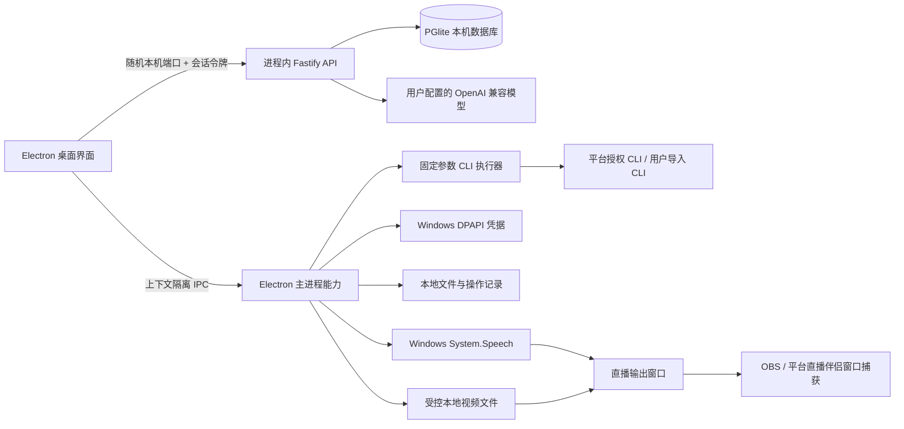
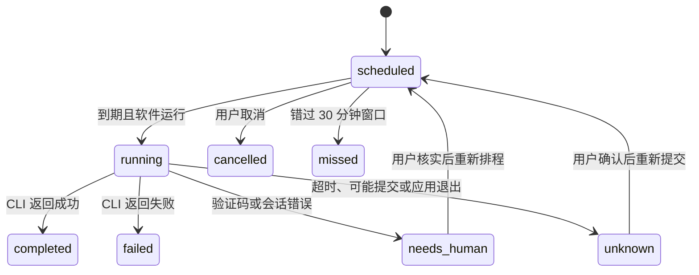

# Windows 桌面应用架构

## 产品边界

Easy Control 是 Windows 本地桌面应用。Electron 主进程持有本机工具、文件对话框、Windows 加密、直播输出和生命周期；React 渲染进程只调用最小化 IPC；Fastify 仅作为进程内业务 API；PGlite 把 PostgreSQL 兼容数据库持久化到应用数据目录。安装、更新或启动不需要单独的云后台、Docker、PostgreSQL 或 Node.js。

下一阶段若规划 Harmony/iOS，应将平台集成、模型调用、作业状态和本地能力声明为共享 TypeScript 合约；将密钥、进程管理、文件挑选、通知、定时策略和音频/视频解码封装成平台实现。当前功能与打包目标只支持 Windows x64。

## 组件与责任

- **Renderer**：React 19、TypeScript、Vite，展示总览、指令、平台工具/账号、模型、素材、排程/结果、异常和直播设置。默认窗口不直接访问 Node.js。
- **Electron 主进程**：`standalone.cjs` 负责单实例、生命周期、托盘、秘密存储、安全 IPC、工具进程和媒体协议。
- **业务引擎**：打包的 API 与既有合约、策略、内容、任务模块在一个 Electron 进程运行。桌面 API 仅绑定 `127.0.0.1` 的临时端口；每个请求还需要随机进程内令牌。外部浏览器不得调用。
- **数据**：数据库、模型供应商、内容工作区与任务记录在应用数据目录；DPAPI 加密本机凭据。CLI 账号独立保存各自的环境变量，不能通过返回值读出凭据。
- **CLI 插件边界**：内置目录列出上游、软件包版本、许可证、支持平台与动作模板；也可导入本机 EXE/JS/CJS/MJS。调用以参数数组传递并禁用 Shell。Npm 包安装禁用 lifecycle 脚本，限定安装到应用数据目录。
- **模型**：用户配置一个 OpenAI 兼容服务。模型只接收用户所写指令和当前工具白名单动作，返回严格校验的动作 ID 和已存在参数；执行权限、账号秘密和确认均由应用控制。
- **直播**：主进程只允许选择本地视频，经注册的 `easy-media:` 路由提供有限文件及 HTTP Range；Windows `System.Speech` 在本机生成 WAV，输出页顺序循环字幕与声音。OBS/平台伴侣负责捕获与实际开播。

## 任务生命周期

排程按本机时间触发；应用退出或电脑休眠期间不执行。重启后中断任务标记为待核实，不补发、不自动重试，避免重复外发。每次调用只启动一个子进程，设超时并限制输出；未执行写操作时不要求身份信息。写操作须选择登记了平台 UID 的账号，并调用同一工具的固定只读 `identity` 动作，匹配 UID 后才启动写命令。变更账号或动作模板会使排程失效。

本地 CLI `completed` 表示子进程退出码为零。除非平台提供可独立查询的公开链接或状态，应用不会把它标成「平台已公开」。

## 安全边界

- Renderer 开启 `contextIsolation`、禁用 `nodeIntegration` 与 sandbox，并拒绝非受控导航；IPC 验证来源为应用窗口。
- 内部 API 不绑定公网；随机会话令牌不会写日志或暴露至网页地址。
- DPAPI 保护软件自身数据库密钥、CLI 环境变量和已保存的模型密钥。它依赖 Windows 当前用户帐户，建议对应用数据目录做受控备份。
- 命令动作模板与用户参数分别显示；参数不拼 Shell。安装时固定上游包版本，禁用上游脚本。
- 输出过滤凭据和常见 Token 格式，写操作要求明确确认。平台响应验证码、权限错误或身份不符时不重试。
- 用户主动导入的 CLI 是本机代码，具有当前用户的本机权限。安装第三方 CLI 与授权前应检查仓库、许可证和版本。
- 连接第三方模型会按供应商设置发送提示词/所选执行结果；敏感账号凭据不进模型上下文。

## 可扩展合约

一个平台工具记录包括 `id/name/version/source/license/platforms/executable/actions[]`。每个动作由唯一 ID、可读标签、`read|write`、受控参数数组和可选身份检查标记组成。账号映射 `toolId/platform/uid/name/secret/revision/paused`；任务记录工具、动作模板指纹、账号修订号、计划时间、执行结果及异常状态。Android/iOS/Harmony 后续可复用这些 DTO 与状态语义，同时必须用平台安全容器、签名应用安装目录和平台可持续运行能力替换 Windows 专属实现。

当前尚无远程任务同步、云端凭据同步、模型对话记忆、跨设备协作、视频渲染、数字人形象或 RTMP 推流。
