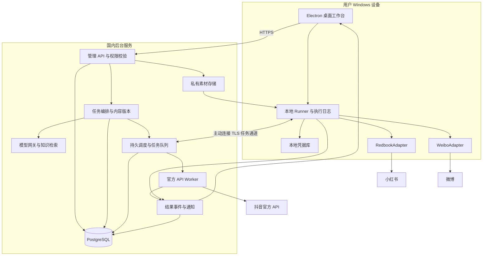
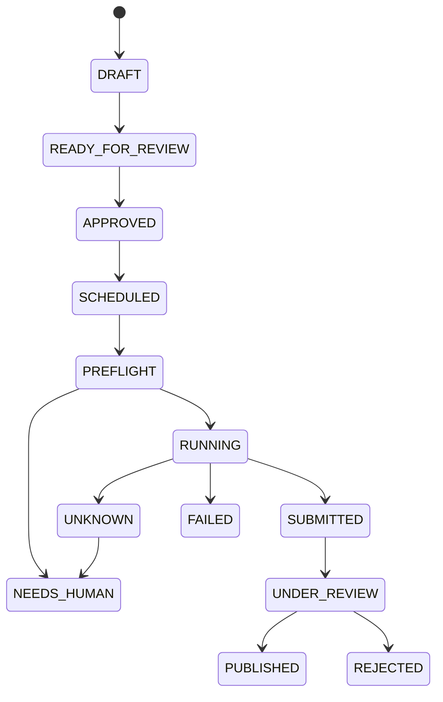

# AI People 建设方案：抖音、小红书与微博

版本：1.0｜日期：2026-10-20｜状态：实施设计，尚未开发和验证真实账号

本文是前期建设草案，已由当前 Windows 桌面应用实现及 [平台矩阵](platforms.zh-CN.md) 取代。特别是小红书方案已收敛为内容助手与真人交付：不接入账号会话、不模拟操作、不做账号读写或互动。请勿按本文后续 redbook 实验适配器段落实施。

## 1. 产品形态与首期决策

建设一个 **Windows 桌面运营工作台 + 后台任务服务 + 本地执行器**。用户在软件中连接账号、配置模型、提供资料、设置运营任务与时间，然后查看进度、接收结果和处理异常。

用户需要配置的是账号、目标和规则，不需要安装命令行工具、手写提示词或拼接命令。安装包负责提供经过验证的执行环境。底层分别使用 API 和 CLI，不要求所有平台都通过鼠标点击操作。

三部分可以部署在同一台开发机联调；正式试点建议后台放在国内服务器，本地执行器安装在用户的 Windows 设备或专用常开 Windows 主机。后续团队网页控制台复用相同业务接口。第一期不增加手机端、通用视觉桌面代理、数字人视频分身或大模型训练。

核心使用流程：

1. 安装软件、登录工作空间，绑定一台执行设备。
2. 连接微博、抖音和小红书账号，核对昵称、账号 ID 与连接状态。
3. 配置模型供应商及密钥，测试文本生成与结构化输出。
4. 上传品牌说明、产品信息、真实案例、原始照片和使用授权。
5. 给助手一个目标，例如“根据这次新品资料准备下周三个平台的内容”。
6. 助手生成平台专用草稿和素材，展示事实依据、AI/商业声明及发布账号。
7. 用户审核具体内容并选择立即发布或定时发布；执行器到时自动操作。
8. 工作台返回发布 ID、链接、平台状态和错误原因，通知用户处理需人工介入的事项。
9. 按配置时间汇总可获取的数据，生成下次内容建议。

首期支持两种自动化模式：

| 模式 | 行为 | 默认范围 |
|---|---|---|
| 自动准备 | 定时选题、生成草稿、整理资料、制作图文、读取授权数据和生成报告 | 三个平台均可配置，读取受实际渠道能力限制 |
| 审核后自动执行 | 用户批准具体账号、具体内容和时间后，按计划发布 | 微博、获批的抖音接口，以及完成首批验证并由账号所有者明确启用的 redbook 实验适配器 |

第一期不开放“模型无限生成并立即发到所有账号”。重复计划可以持续生成草稿；每篇外发内容有独立版本和发布许可。微博可在限定范围内预授权已审核内容队列；抖音须满足官方要求的逐次操作明确感知；小红书执行依赖会话、声明与账号状态验证。用户不需要守着每个操作步骤，但需要处理登录、验证码和内容决定。

## 2. 三个平台的接入选择

| 平台 | 执行通道 | 账号连接方式 | 首期上线动作 | 已知依赖 |
|---|---|---|---|---|
| 小红书 | 固定版本 redbook，由本地 Runner 包装 | 账号所有者明确提供自己的有效会话，保存在本地 | 图文准备、受限读取、审核后的单篇图文发布；自有笔记评论生成回复草稿 | 非官方接口、会话失效、验证码、内容声明能力和发布结果核验 |
| 抖音 | 官方开放平台 API，由后台 Worker 调用 | 开发者应用获批 + OAuth 用户授权 | 视频/图文发布及获批的数据读取 | 应用和 scope 审核、用户对每次代发明确知情、平台内容审核。[R5] |
| 微博 | 官方 weibo-cli，由本地 Runner 包装 | 开发者认证、服务开通 + OAuth | 发博、授权数据读取；单条评论回复在人工确认后执行 | 账户套餐/积分、命令权限、AI 内容属性声明。[R9] |

小红书采用 redbook 解决“有无可调用实现”的问题，不表示消除了平台对 AI 托管的治理风险。账号所有者在连接时可以了解并选择启用实验功能；它是一次清楚的产品选择，无需每个任务重复阅读风险提示。遇到平台明确拦截就停止，不通过更换账号、隐藏身份、验证码代解或修改反检测参数继续操作。[R1][R6]

## 3. redbook 的源码评估与集成原则

本次只读取源码，没有安装依赖、执行上游脚本、获取用户 Cookie 或调用真实账号。

审查快照：`@lucasygu/redbook`，源码包版本 `0.8.2`，Git 提交 `801a09847699a2bae5560eeefd901e3afdde469b`，Node 要求 `>=22`。快照位于本地 `.research/redbook`，实现时必须固定版本并审查依赖与安装钩子，不能自动安装 latest。[R1][R2]

| 已检查的代码事实 | 对产品的影响 |
|---|---|
| 提供图文发布和读取方法；作者说明调用非官方接口 | 小红书适配器独立开关、独立升级，不能承诺官方服务等级 |
| 支持显式会话文件 | 每个账号单独绑定本地凭据；缺少文件就失败，禁止回退扫描其他浏览器账号 |
| `post --json` 仍输出上传等进度 | 增加结构化包装层，不能对整段 stdout 直接 JSON.parse |
| 库方法含定时选项，但 CLI post 未暴露对应参数 | 定时统一由本系统负责，第一期不依赖平台原生定时 |
| 检查的发布选项未暴露专门 AI 声明参数 | 作为上线验证项；不能假定文案里写 AI 就等同平台声明功能 |
| 安装钩子会注册外部技能 | 生产分发审查安装钩子，禁止未经用户选择修改其他助手配置 |

这些是该提交的静态审查结果，不代表 npm 发布包与 Git 快照相同，也不代表发布成功率已经实测。构建时要比对最终分发包、版本和完整性摘要。[R2][R3][R4]

集成方式采用自有的 `RedbookAdapter` 进程包装器：

- 先使用固定的只读/发布命令集合；没有通用“执行任意命令”入口。
- 优先调用上游已导出的客户端封装形成统一结果，不重写平台签名或设计反检测算法。若必须调用 CLI，使用参数数组和 `shell:false`，处理中文、换行、文件路径和 Windows 长参数限制。
- 发布意图、上传、提交、结果写入本地执行日志；进度和业务结果走两个通道。包装器最终只返回一个规范 JSON 结果。
- 所有外发动作核对连接的账号 ID；不能只凭账号昵称判断。昵称可以变化，UID 才用于绑定。
- 小红书范围固定大陆平台，不自动探测和切换海外后端。
- 首期关闭上游 `batch-reply`、自动收藏和账号批量互动能力，不使用其反检测节奏建议。账号内串行是为了避免并发错误，不是为了假装真人。
- Cookie 无法恢复时由用户通过正常登录重新连接，不读取或绕过浏览器受保护的凭据存储。

AI 及商业声明的验收必须包含“账号实际能设置哪些声明”。如果 redbook 无法满足某篇内容所需声明，该任务转 `NEEDS_HUMAN`，在官方创作工具完成声明与发布；不得自动删掉声明要求继续提交。保留此降级路径是实际可上线的前提。

## 4. 架构设计



模型只提出结构化计划和内容。任务服务校验权限、审批版本、账号状态、素材和预算后，执行器才有资格运行相应动作。网页、评论、资料里的文字始终当作内容，不当作系统命令。

### 4.1 桌面端

Electron + React + TypeScript。界面只加载本产品资源，使用隔离的 preload 桥；开启 contextIsolation 和沙箱，不向网页暴露 Node、文件系统或原始执行接口。外部平台登录使用系统浏览器或平台官方应用。[R8]

桌面界面退出时，用户可选择最小化托盘保持 Runner 工作。首期 Runner 作为独立后台进程，在用户登录 Windows 后启动，不假定 Windows 服务在无交互桌面时能处理所有登录行为。软件更新、注销 Windows、设备休眠和关机都会影响本地任务。

### 4.2 后台

Node.js + TypeScript + Fastify；PostgreSQL 存业务数据；pg-boss 存延迟任务、执行队列和重试记录。第一期不同时引入 Redis、Kafka 和复杂微服务。pg-boss 提供基于 PostgreSQL 的任务和调度能力；外部平台的写入副作用仍需本系统独立处理。[R7]

任务创建与入队采用事务性 outbox：业务事务同时写任务和出站事件，由分发器可靠投递，避免“界面显示排程成功但没有入队”。允许消息重复投递，通过唯一键去重。后台拆为 API 进程、调度/编排进程、官方 API Worker，使用同一代码库部署。

试点可用一台国内 Linux 主机运行后台容器和 PostgreSQL，素材放私有对象存储；初始容量按 3–5 家客户、总计不超过 10 个授权账号规划。主机规格在负载验证后确定，先用约 2–4 核、4–8 GB 内存作为起点，不把模型推理放在这台主机上。入口只开放 HTTPS，数据库不向公网开放。小红书/微博使用常开 Windows 主机，适配器操作串行，后台生成任务不受前台窗口关闭影响。

### 4.3 本地 Runner

Runner 携带经过验证、满足工具版本要求的 Node 运行环境与适配器；客户不需要自己安装 npm。它主动向后台建立 TLS 长连接或轮询，不开放外网入站端口。

设备绑定由一次性配对完成，换取可撤销的设备凭据。任务信封绑定设备、工作空间、账号和内容摘要，Runner 接收后再次核实，不接受任意服务器字符串作为本机命令。

本地用 SQLite 保存任务收据、提交意图和结果缓存：完成操作但断网时先落盘，网络恢复后上报。后台对结果重复上报进行去重。

### 4.4 适配器位置

抖音应用密钥和 OAuth 令牌由后台密钥存储保管，桌面软件不内嵌 App Secret；官方 API Worker 执行。小红书会话与微博 CLI 会话优先留在用户本机，由本地 Runner 执行。模型拿不到任何平台凭据。

微博多账号是否支持独立 CLI 配置须实测；在没有核实配置隔离能力前，MVP 每个 Runner 只绑定一个微博会话。扩容通过明确支持的账号配置或独立系统用户运行实例完成，不猜测设置 HOME 就能隔离。

## 5. 用户界面与配置

首期做八个核心页面：

| 页面 | 用户看到与完成的事项 |
|---|---|
| 总览 | 今日任务、待审核、执行设备在线状态、待处理异常和近期结果 |
| 账号中心 | 平台、头像/昵称、UID、连接方式、凭据状态、可用能力、连接/断开 |
| 助手与模型 | 模型供应商、模型名、密钥连接测试、品牌口吻和任务预算 |
| 资料与素材 | 产品知识、真实案例、原始图片/视频、版权、授权范围和有效日期 |
| 内容工作台 | 同一选题的三平台版本、事实引用、预览、编辑、AI/商业声明和审核 |
| 任务与日历 | 单次/重复计划、时区、执行账号、到期策略、暂停和取消 |
| 结果与数据 | 原文、提交回执、发布链接、平台状态、数据时间和复盘 |
| 异常处理 | 登录失效、验证码、声明缺失、余额不足、提交结果未知和处理入口 |

平台接入不是简单填 API Key：微博和抖音的账号授权、抖音开发者权限、小红书会话连接是不同流程。软件把差异包装为同一种“连接账号”体验，同时展示各平台真实状态。

每个账号可配置：允许动作、内容负责人、所需确认方式、执行设备、素材范围、工作时段、任务上限和单日费用预算。所有这些是业务控制，不宣称设置某个发帖数量即可规避封号。

## 6. 授权、会话与撤销

授权分四层：

1. 工作空间权限：管理员、运营编辑、审核人、只读成员。
2. 账号使用许可：用户选择明确的账号，指定可读取/发布/回复等动作。
3. 平台能力：OAuth scope、服务套餐或第三方适配器实际可用功能。
4. 任务许可：具体内容版本、目标账号、动作、时间窗口与预算。

权限服务同时检查四层；平台有发布权限不意味着模型可以无限发布。用户在连接时启用某个账号，不需要每次任务重新登录；连接失效才重新授权。

小红书会话只由账号所有者明确提供或通过受支持的正常登录流程建立。每账号独立密钥标识。磁盘长期加密保存，调用时如上游要求文件，则解密到仅当前系统用户可访问的短生命周期文件，执行后清理。Windows 必须设置实际 ACL，不能把 Unix 的 0600 当作 Windows 隔离保证。

包装器显式指定会话文件；文件缺失、平台不匹配或 UID 不符就中止，不自动回退到其他 Chrome 账号。秘密不出现在命令行参数、模型上下文、前端状态、任务 JSON、日志、截图和通知中。

点击“断开账号”立即阻止新任务、撤销任务许可并处理尚未开始的任务。已进入提交阶段的操作先核实结果；对于官方 OAuth 引导撤销授权，对于会话方式提示用户通过平台正常退出/会话管理使其失效。本地删除文件不能承诺远端会话已撤销。

## 7. 模型如何参与操作

不训练基础模型。设置一个可替换的模型网关，提供供应商适配、结构化输出校验、超时、费用计量与版本记录。管理员配置端点和密钥；普通任务与评论内容不能指定任意端点或改变工具权限。

职责分为：

- 目标理解：把自然语言变为平台、账号、动作、素材、时间和确认条件。
- 内容制作：根据真实资料生成脚本、文案、标题和图文卡片建议。
- 问答辅助：结合产品资料和原始评论生成回复草稿，证据不足时请求补充。
- 运营复盘：根据有时间戳的数据提出原因假设与实验建议，不把相关性说成因果。

品牌资料优先结构化字段和全文检索，资料量确实需要时再增加向量检索。内容版本保留来源 ID 与模型信息，不能凭风格设定编造亲身体验、销量、学历或客户案例。

工具接口按能力定义：`prepare_content`、`get_own_comments`、`publish_approved_content`、`reply_approved_comment`、`get_publication_status`。每个工具都有严格参数与工作空间校验，没有 `run_shell` 或 `do_anything`。

下面是产品内部任务结构示意，不是 redbook 原生命令或可直接运行的配置：

```json
{
  "task_id": "task_001",
  "workspace_id": "workspace_001",
  "platform": "xiaohongshu",
  "account_id": "account_001",
  "action": "publish_image_note",
  "content_version_id": "content_v3",
  "content_hash": "sha256:...",
  "approval_id": "approval_001",
  "scheduled_at": "2026-10-21T10:00:00+08:00",
  "timezone": "Asia/Shanghai",
  "expires_at": "2026-10-21T10:30:00+08:00",
  "runner_id": "runner_001",
  "retry_policy": "reconcile_before_retry"
}
```

## 8. 定时与全天运行

支持四类任务：单次发布、周期生成草稿、周期读取数据、周期生成日报。重复任务生成独立的执行实例；一个定时发布条目只对应一个确定版本，不能每次运行时偷偷换成模型新生成的内容。

时间默认 Asia/Shanghai。数据库保存 UTC 执行时间、用户时区和重复规则；界面显示北京时间。用户可以通过表单选择每周几、几点，不必手写 cron。

调度服务提前生成未来执行实例，以 `schedule_id + occurrence_at + account_id + action` 建唯一键。停机恢复时扫描数据库补齐缺失实例，不只依赖队列在准确那一秒触发。任务到期后核实当前规则、版本和设备状态，再发放执行许可。

本地设备每约 30 秒报告心跳，90 秒未响应暂判离线；这些是初始工程参数，和平台请求频率无关。离线期间任务显示 `WAITING_RUNNER`，不会虚报正在发布。

默认错过发布时间超过 30 分钟就标记 `MISSED`，通知用户重新安排；用户也可配置“30 分钟内上线补发”。到期策略事先写入任务，不集中补发已经过时的排程。节日活动、价格和库存到期后必须重新核实内容。

**软件支持定时，不意味着关机后本地 CLI 仍能运行。** 小红书和本地微博任务需要常开且联网的 Runner；建议试点使用专用 Windows 小主机。抖音后台 Worker 的任务不依赖用户电脑在线，但仍依赖授权和用户确认条件。纯云端小红书会话迁移另做验证，第一期不把凭据自动上传云服务器。

## 9. 发布、互动与结果状态

### 9.1 发布流程



校验内容包含：当前账号 UID、内容与素材哈希、会话有效性、审批有效期、发布声明、依赖文件、预算、账号是否被暂停，以及同账号是否已有提交状态未明的任务。

执行许可冻结内容、账号、素材顺序、可见性、平台、动作和时间窗口。用户修改任一关键内容后重新审核，不在已排程任务中自动覆盖旧版。

通过外部 CLI/API 收到成功回执，只能先标记已提交。核实平台状态后才显示公开发布。若只有创建回执、读不到审核字段，界面如实显示“已提交，公开状态未确认”，不擅自填已发布。

每个平台有自己的 Publication；一个跨平台任务可部分成功。例如微博成功、小红书需验证、抖音待审核。界面分列三个结果，不能用总任务的一个绿色状态掩盖失败。

### 9.2 去重、重试和断网

本系统能保证任务记录和结果事件去重，不能保证对方平台对所有请求提供 exactly-once 写入。

任务采用数据库租约和账号锁。Runner 在接收任务时生成本地记录，进入不可逆提交前落盘 `COMMIT_INTENT`。断网或进程重启后发现已有提交意图但无完整结果，就进入 `UNKNOWN`，先对账。过期 Worker 的提交结果仍可被收集，但不能获得第二次写入许可。

新外发必须在线获取短期执行许可并确认取消/撤销状态；断网后不擅自开始缓存中的写任务。全局暂停阻止后续提交，但已经发往平台的请求可能无法撤回，需照常收集结果。队列租约过期不能自动证明外部请求没有发生。

上游原生命令若不能暴露可靠的提交边界，则从启动写命令起保守标记“可能已提交”。不能仅凭“Publishing”进度文本判断一定没发出去。自动重试的范围只包括能证明未提交的平台错误和安全的读取；发帖超时不自动重新发帖。

| 情况 | 处理 |
|---|---|
| 未开始执行就离线 | 等设备恢复，在有效窗口内再领取 |
| 读取网络失败 | 有上限地重试，并服从平台返回的等待窗口 |
| 上传失败且明确未创建作品 | 保留任务信息，确认平台允许后重试上传 |
| 发布提交后断线 | UNKNOWN，核实作品 ID/发布记录，无法可靠确定就人工处理 |
| 验证码或平台拦截 | NEEDS_HUMAN，暂停该账号外发，由真人在平台正常处理 |
| 会话失效、权限收回、服务余额不足 | 暂停并通知重新连接、授权或充值 |
| 内容审核拒绝 | 展示原因，修改后生成新版本，不反复换词冲撞审核 |

平台未提供可靠回读时允许用户人工登记作品链接，但必须标记“人工确认”，不与接口确认混淆。

### 9.3 评论与宣传

首期只处理自有内容下的正常提问，自动分类和生成回复，人工确认具体目标和文本后逐条发送。退款、价格承诺、投诉、隐私和法律争议交给人。去重键包括平台、账号和原始评论 ID，防止重复回复。

不以关键词搜索结果向陌生用户批量营销回复；不做批量私信、刷赞、互赞或假用户评价。推广内容注明真实经营身份，AI 和商业合作声明分别检查。小红书先不上线自动回复，后续根据发布 PoC 和实际规则单独评估。

## 10. 返回什么结果、如何通知

界面实时订阅任务事件；断线后按事件序号补拉。后台保留最终结果、每次尝试和外部回执。桌面通知用于完成、失败、需人工操作三类重要事项，不每个上传步骤弹窗。

结果包含：

```json
{
  "task_id": "task_001",
  "platform": "xiaohongshu",
  "account_id": "account_001",
  "execution_status": "submitted",
  "publication_status": "unverified",
  "external_id": "platform_returned_id",
  "url": null,
  "confirmation_source": "adapter_receipt",
  "next_action": "wait_or_verify",
  "evidence_id": "evidence_001",
  "cost": {"model_cny": 0.25},
  "finished_at": "2026-10-21T02:00:12Z"
}
```

这是内部格式示例。链接必须由平台真实返回或根据经验证的规则生成并核实；没有链接就显示尚无链接。模型费用只是示例，不是报价。

日报按用户指定时间在软件内生成，并可导出 Markdown/CSV。以后接企业微信或邮件通知时，由管理员单独配置接收人和发送授权；第一期不要求接入外部消息系统。

## 11. 数据、接口与代码组织

主要数据实体：

| 实体 | 关键字段 |
|---|---|
| Workspace / Member | 工作空间、成员、角色、状态 |
| AccountConnection | 平台、UID、显示信息、认证方式、能力、secret_ref、会话状态 |
| Runner | 设备、绑定工作空间、可用适配器版本、心跳、撤销状态 |
| BrandProfile / Source | 真实资料、来源、版权、负责人、过期时间 |
| Asset | 内容哈希、存储位置、类型、授权、AI 参与和素材状态 |
| ContentVersion / Approval | 平台版本、素材清单、声明、审核者、内容摘要、有效期 |
| Schedule / Task / Attempt | 重复规则、实例时间、任务状态、租约、尝试与提交意图 |
| Publication / MetricSnapshot | 平台内容 ID、回执、公开状态、指标采集时间与来源 |
| Event / Incident / CostLedger | 去重事件、异常处理、费用和审计 |

云端仅保存本地凭据引用，不保存小红书明文会话。租户查询、对象存储下载和模型检索都校验 workspace_id；数据层增加行级约束，不能只在界面筛选。成员退出后同步撤销权限、设备绑定和未开始任务。

建议业务 API：

```text
POST /account-connections
POST /runners/pair
POST /contents/prepare
POST /content-versions/:id/approve
POST /tasks
POST /schedules
POST /tasks/:id/cancel
GET  /tasks/:id
GET  /task-events?after=...
POST /runner-results
POST /incidents/:id/resolve
```

任务创建与结果上报带幂等键；跨平台任务产生独立子任务。对外不开放随意传 CLI 命令的 API。

建议代码结构：

```text
apps/desktop/                  Electron、React、账号连接与任务界面
apps/api/                      身份权限、内容版本、审核和结果 API
apps/worker/                   调度、任务编排、官方 API 执行
apps/runner/                   本地任务领取、会话、日志与断网恢复
packages/contracts/            数据协议、动作 schema、状态和错误码
packages/connectors/redbook/   固定版本包装、图文发布与受限读取
packages/connectors/weibo/     官方 CLI、命令目录、AI 属性与额度
packages/connectors/douyin/    OAuth、发布、状态与获批数据接口
packages/model-gateway/        模型供应商、结构化计划与费用
packages/policy/               账号许可、版本校验、预算和熔断
packages/knowledge/            真实资料、引用、版权和有效期
infra/                        后台容器、数据库迁移与备份恢复
docs/                         本方案、接口协议和运行手册
```

## 12. 工程风控与维护

这里的风险控制是减少事故和影响范围，不是承诺隐藏自动化。

- 每账号同一时刻一个写任务；有未明提交时暂缓该账号后续写入。
- 按平台正式额度和具体任务预算排队；没有平台安全阈值时不编造“每天几篇不封号”的数字。
- 出现验证码、权限拒绝或平台警告就暂停对应能力；其他平台任务可继续。
- 发布前核实真实素材、事实、AI/商业声明与版权；被拒内容交人处理。
- 日志脱敏、秘密加密、桌面隔离、任务信封校验；模型不能看到或自行发送凭据。
- 从网页、评论和模型拿到的文件名、链接和 HTML 不直接执行；素材下载控制域名、大小、类型，防止 SSRF、恶意文件和本地越权读取。
- 第三方包固定版本、保存完整性摘要、保留许可证与版权声明。升级在验证环境先跑兼容性检查，有问题回滚；不在活跃发布过程中升级。
- redbook 上游接口失效时单独停用其能力，维护窗口后恢复；不自动切换新账号、换 IP 或浏览器渠道来冲过拦截。
- 数据库备份、对象存储备份与恢复演练；初期恢复目标可设 RPO 24 小时、RTO 4 小时，作为试点目标而非已提供的 SLA。恢复后冻结受影响时间窗口内的写任务，结合平台回执和本地执行日志对账，不能按旧备份自动补发。

小红书平台的托管规则风险、接口失效风险、账号限制风险会长期存在。产品展示“第三方实验连接器”，不以官方合作、零风险或保证涨粉销售。用户已经表达愿意承担账号风险，不需要反复请求同样确认；产品仍要提供明确状态、暂停与撤销控制。

## 13. 实施计划与交付标准

建议 3 名工程师，另配熟悉真实账号运营的产品/运营负责人，目标约 8–10 周；如果只有 2 名工程师，按约 10–14 周规划。首批平台验证未通过时先缩小上线动作，不承诺用反检测手段补齐失败项。抖音审批与微博认证等待时间不包含在工程保证内。

| 阶段 | 时间 | 交付 |
|---|---|---|
| 平台 PoC | 第 1–2 周 | 固定 redbook 版本；用户授权下核验会话隔离、图文提交、声明支持和结果回读；微博认证/CLI 验证；抖音应用与权限申请 |
| 基础工作台 | 第 3–4 周 | 桌面壳、工作空间、账号连接、执行设备、模型网关、资料和内容版本 |
| 内容与调度闭环 | 第 5–6 周 | 平台专用草稿、预览审核、定时任务、离线处理、执行器与结果通知 |
| 恢复与试点 | 第 7–8 周 | 未明状态处理、撤销、熔断、发布对账、备份恢复和真实客户试点 |
| 加固与交付 | 第 9–10 周 | 缺陷修复、安装升级、运行文档、成本复盘和用户培训 |

首个业务里程碑：**用户在软件里批准一篇具体内容并设定北京时间，工作台在设备可用时执行，到结果页给出准确状态；有问题时清楚地要求人工接管。** 完成这一闭环后，再增加内容研究和互动，不先堆复杂的通用代理。

PoC 的硬性验证项：

1. 小红书所需发布声明是否能通过现有工具正确设置；如果不能，明确人工降级路径。
2. 小红书图文提交是否实际可用、何时遇到验证码、能否返回可靠 ID 和公开状态；测试目的为测能力，不为寻找绕过拦截的方法。
3. 账号 A 的任务绝不能读取账号 B 的会话；缺凭据要停止，不能自动匹配其他浏览器配置。
4. 微博命令目录、AI 标识、套餐和认证条件，以实际账号输出为准，不复制旧接口假设。
5. 抖音权限、声明字段和每次代发明确感知的交互，是否满足实际应用审核要求。

上线验收目标（均非当前实测成绩）：

- 至少覆盖 100 个功能与故障场景，包括断网、进程崩溃、重复消息、过期审批、凭据撤销、时间到期和提交结果未知。
- 不发生错账号写入、未经许可外发、已修改内容沿用旧审批和凭据泄漏；任何发现都阻断上线。
- 外部任务有真实回执或明确标记未知，不能把 CLI 退出码 0 当成公开发布成功。
- 云端调度在健康条件下目标延迟不超过 60 秒，本地执行受设备在线和平台耗时约束；超时、验证码不算成功。
- 图文内容准备人工耗时相对客户基线下降至少 50%；报告样本量、人工介入率和失败原因，避免只选成功样本。
- 小红书独立报告提交率、公开状态确认率和人工接管率；不给其套用其他官方渠道的成功率。

## 14. 人力与运行成本

前期研究给出的 40–70 万元属于较完整团队成本的规划范围，并非本项目固定报价。根据当前收缩范围，先按人周核算更可靠：

- 平台验证和适配：约 4–6 工程人周。
- 桌面、后台、模型、内容和权限：约 8–12 工程人周。
- 调度恢复、测试、分发和试点修复：约 6–10 工程人周。
- 合计约 18–28 工程人周，3 人按约 8–10 周、2 人按约 10–14 周规划；阻塞平台问题另计。

若工程全成本假设为每人月 3–5 万元、每月按 4.3 周换算，工程约 12.6–32.6 万元；加入约 20% 机动约 15.1–39.1 万元。产品、运营、设备、平台服务、模型、商业合规和代码签名费用另计。这些是估算假设，不是市场报价或交付合同。

运行成本用实际计量：模型输入/输出及图片调用、平台积分/API 服务、国内服务器与存储、本地常开设备、人工审核和异常处理。初期基础设施可先按每月 300–1,000 元做预算占位，采购时替换为供应商实价；模型与平台调用单独计费，不承诺统一包月价。

先使用已有设备、成熟模型和普通对象存储，不自训模型、不建设 GPU 集群。商业上应按账号/工作空间、执行任务量与服务支持计费，不按调用次数掩盖失败重试成本。

## 15. 最终建设顺序

按用户已经确定的方向：小红书使用 redbook 作为实验适配器；微博使用官方 CLI；抖音使用官方 API。后台统一模型、内容版本、调度、许可和结果，本地 Runner 负责需要本机会话的执行。

工程先并行完成三平台验证，优先打通微博与桌面任务闭环，同时验证小红书提交与声明能力、启动抖音审核。随后接入可用的小红书图文发布与抖音接口。首期交付的软件能连接账号、生成内容、审核、定时执行和回传结果；平台拦截或必要能力缺失会如实进入人工处理。

## 参考资料与审查范围

核对日期：2026-10-20。官方规则、CLI 服务与第三方实现可能更新。源码审查不等于真实账号验证。

- [R1 redbook 项目及功能说明](https://github.com/lucasygu/redbook)
- [R2 固定快照 package.json](https://github.com/lucasygu/redbook/blob/801a09847699a2bae5560eeefd901e3afdde469b/package.json)
- [R3 固定快照 CLI 源码](https://github.com/lucasygu/redbook/blob/801a09847699a2bae5560eeefd901e3afdde469b/src/cli.ts)
- [R4 固定快照客户端源码](https://github.com/lucasygu/redbook/blob/801a09847699a2bae5560eeefd901e3afdde469b/src/lib/client.ts)
- [R5 抖音官方创建视频说明](https://open.douyin.com/platform/resource/docs/openapi/video-management/douyin/create/create-video/)
- [R6 小红书 AI 托管治理公告报道](https://www.chinanews.com/cj/2026/03-10/10584783.shtml)
- [R7 pg-boss 官方项目](https://github.com/timgit/pg-boss)
- [R8 Electron 进程沙箱说明](https://www.electronjs.org/docs/latest/tutorial/sandbox)
- [R9 微博官方 CLI 使用手册](https://open.weibo.com/cli/quickstart)
- [R10 小红书官方社区公约](https://pgy.xiaohongshu.com/help/detail?id=1eda0a065dd894063c2e029a49e8f6a1&userType=4)
- [R11 人工智能生成合成内容标识办法](https://big5.www.gov.cn/gate/big5/www.gov.cn/zhengce/zhengceku/202503/content_7014286.htm)
