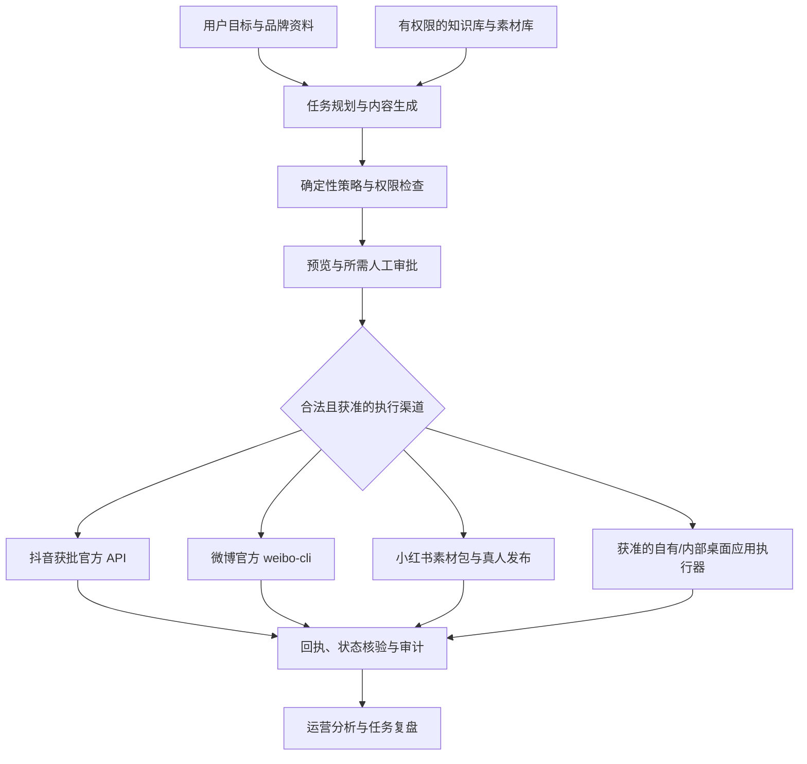

# 抖音、小红书与微博 AI 运营助手：专项方案与风险边界

> 此文件保留为前期研究记录。当前实施以 [最终建设方案](construction-plan.zh-CN.md) 为准：小红书采用 redbook 实验适配器，平台拦截转人工；本文曾将所有非官方写入一概排除的实施结论已被新方案修正。

研究日期：2026-10-20。适用项目：`G:\pjs\aipeople`。

本次检查目录起初为空，没有 Git 仓库或现有实现。本文件聚焦抖音、小红书和微博，不包含海外平台，也不代表已取得第三方授权或验证生产账号。

## 1. 决策建议

项目值得做，但对外承诺应为：**用户授权、可监督、可审计的抖音、小红书与微博运营助手**。操作能力是底层基础；能否对某个平台自动发布或互动，必须逐项满足平台规则与正式授权。

“完全模仿真人”需要拆成两件事：

- 操作能力：理解页面和应用，定位控件、填写、上传、读取结果。这条路线可建设，但限定任务集才能给出可靠性承诺。
- 身份与行为：伪装真人、虚构亲身体验、绕过反机器人机制、自动制造互动。这条路线不能作为长期运营和账号安全的基础，也不应通过模拟真人键鼠、随机延时、指纹伪装、代理轮换或验证码代解来实现。

第一版选择 **抖音官方发布接口 + 微博官方 weibo-cli + 小红书真实素材辅助创作与真人发布**。微博现有官方 Agent 命令行工具，可在认证、OAuth 授权和额度条件满足后执行发博等操作。另行建设通用桌面操作能力，但仅在用户拥有或获得许可的应用中验证；它不会自动成为小红书账号的许可发布通道。

建议商业切入：有自有素材和专业知识的中小品牌、企业运营团队。试点暂按 3–5 家、总计不超过 10 个真实授权账号设计；这是工程控制范围，不是平台安全额度。

## 2. 研究结论与证据边界

| 平台/规则 | 本次核实结果 | 产品决策 |
|---|---|---|
| 抖音开放平台 | 官方 `video.create` 需要申请接口权限和用户授权；内容创建后会经过审核。代用户创建内容时，每次调用都必须让用户明确感知，否则可能回收接口权限并处罚。[S4][S5][S10] | 作为主发布通道。逐账号 OAuth 授权；发布前展示预览并逐次明确确认；发布、删除、数据和评论分别申请权限 |
| 抖音分享 SDK | 官方分享能力支持用户从第三方 App 将内容交给抖音，并由用户在抖音创作环境继续编辑；这与服务端直接发布是不同交互。[S6] | 权限申请未获批时可评估 SDK 分享体验；确认 SDK、宿主和客户端上架条件，不把分享等同后台无人值守发布 |
| 微博开放平台 weibo-cli | 官方推出面向 Agent 的 CLI，OAuth 授权后可调用发博、互动、检索和数据接口；需微博客户端扫脸完成开发者认证，开通体验服务或购买积分包。[S13][S14] | 纳入正式自动化通道。用微博官方 CLI 的接口能力，不以网页键鼠模拟发帖；写操作保留预览和人工确认 |
| 微博 AI 内容标识 | 官方 CLI 手册要求，AI 生成博文在发布时声明 AI 属性，由系统添加 AI 生成标识。[S13] | 记录内容的 AI 生成/辅助来源，调用 CLI 发布时必须正确声明；不能移除或隐藏标识 |
| 小红书社区公约 | 官方帮助中心显示 2026-07-31 版本，倡导说明 AI 参与、尊重真实和原创，禁止虚假人设。[S1] | 围绕用户提交的真实经历和素材创作；披露 AI 参与；未核实事实标记待补充 |
| 小红书 AI 托管治理 | 2026-03-10 薯管家公告全文由多家媒体转述：治理 AI 自动生成、代发笔记及模拟评论、私信、群聊；普通账号偶发代写代发可能被警告或限制分发，托管注册运营或所有公开笔记均由托管代发可能被封禁。[S2][S3] | 小红书账号的自动登录、模拟键鼠发布、自动评论/私信/群聊列为禁用。加入审批、随机停顿或更像真人的动作不改变这条风险边界。第一版做内容助手和真人交付 |
| 小红书开放平台与蒲公英 | 官方开放平台开发文档主要列出店铺商品、订单等类别；蒲公英 API 面向品牌合作和数据服务，帮助文档披露近一年品牌消耗门槛及白名单条件。本次没有找到通用第三方自动发布笔记 API 的公开规范。[S7][S8] | 市场服务或蒲公英商业合作 API 不等同于账号托管发布许可。没有针对本产品、账号类型和动作的书面许可前，不做账号发布执行器 |
| 非官方 `@lucasygu/redbook` CLI | README 表明它能搜索/读取笔记、分析账号、发图文、评论和批量回复；基于浏览器 Cookie、自行实现请求签名与创作者接口。作者明确称其使用非官方 API、与小红书无关联，且发帖可能触发验证码。[S15] | 这验证了“技术上能操作”，但不是官方授权通道；不把它当作可规避平台 AI 托管规则的依据。可以单独评估只读研究能力；写入能力未获平台许可前不接入生产工作流 |
| 国内 AI 标识 | 《人工智能生成合成内容标识办法》自 2025-09-01 起施行，规定发布者主动声明义务并禁止恶意处理标识。[S9] | 内容血缘、平台声明功能和素材标识进入发布前检查；商业合作标识与 AI 标识分别处理 |

证据限制：小红书托管公告通过转载薯管家公告的媒体全文核实，未直接取得站内原帖；社区公约来自官方帮助中心。小红书接口未检索到公开规范，只能说明当前证据不足，不能证明特殊合作 API 绝对不存在。对外承诺须等平台明确回复具体产品、账号类型和动作后再调整。

**AI 标识、账号授权、用户确认和平台对自动化方式的许可是不同条件，任何一项不能代替其他项。** 抖音官方接口要求用户明确感知每次代发；微博 CLI 支持 Agent 在用户授权范围内调用，但写操作仍建议人工确认；小红书禁止模拟真人托管，真人终审不构成机器人代发许可。

## 3. 产品交付形态

用户给出一个业务目标，例如“把这次真实产品演示改成抖音视频、微博图文和小红书笔记”。系统完成：

1. 收集用户授权的产品说明、素材、案例和禁用表述，建立可追溯知识库。
2. 把目标拆成选题、证据收集、平台适配、素材制作、审核与发布任务。
3. 生成平台专用版本，标记事实依据、AI 参与、商业合作和待补材料。
4. 抖音和微博展示目标账号、作品预览、素材、AI/商业声明和即将执行的动作。
5. 抖音获批后调用官方 API，微博在认证和 OAuth 授权后通过官方 CLI 发布；小红书生成笔记、封面和素材包，由真人通过官方应用或平台允许的工具编辑发布。
6. 获取抖音与微博 API 回执和审核状态；小红书由运营确认发布结果，或通过平台明确允许的数据功能回流。
7. 总结表现，提出下一轮实验，由运营决定是否调整方向。

小红书交付为文案、封面建议、图片顺序、AI 参与声明建议、商业标识检查和事实核对清单。当前不自动登录账号、填写发布页面、点击发布、评论、私信或群聊；只有取得平台明确允许此自动化方式的书面许可后，才评估对应动作。

“回答与宣传”分开：知识回答以相关问题和真实证据为基础；品牌推广走平台允许的商业路径。不做关键词扫帖后批量营销回复、群发私信、刷赞互赞或批量关注。抖音互动权限须单独申请和评估，不纳入本期自动化范围。

### 3.3 微博官方 CLI 自动化闭环

1. 由账号所有者完成微博开放平台开发者认证，并在「我的服务」领取 7 天体验服务或购买正式积分包；官方 CLI 手册当前列出正式积分包 ¥69 起、有效期 365 天。正式开始前核对控制台当时价格、白名单接口与权限。
2. 在可信的本地执行环境安装微博官方 `@weibo-ai/weibo-cli`，运行 `doctor` 核查认证、服务和额度，再通过浏览器 OAuth 登录账号。Agent 只可使用该账号明确授权的 CLI 能力。
3. 先用 `commands list --available` 和 `commands show` 探测当前账户可用接口及必填字段，不在应用中写死未经核实的服务权限。
4. 用户查看微博账号、文案、图片、AI 生成声明与商业信息。获得本次发博确认后，执行官方发布命令并留存微博 ID；CLI 发布 AI 生成内容时需设置 AI 属性，由平台添加标识。
5. 按发布接口回执、博文 ID 和已授权读取接口核实结果；失败或不确定时查回执再处理，避免重复发博。
6. 评论、回复、转发、关注和私信是独立的写操作。CLI 文档建议这些操作保留人工确认；本期仅在用户明确授权、用途合规且人工确认具体文本后执行单条互动，默认不做批量自动回复或私信。

官方体验服务通常按接口给白名单次数，写入接口通常每个接口 3 次；正式服务写入类 POST 总限制为每小时 60 次。以账户当前服务状态和官方命令目录返回值为准。这是接口上限，不是推荐的运营频率。[S13]

### 3.1 抖音自动发布的具体闭环

1. 开发者在抖音开放平台注册应用并通过平台审核，申请 `video.create` 权限；是否可用于本产品及代客户运营，以应用实际获批范围为准。
2. 账号所有者通过抖音 OAuth 流程逐账号授权。保存 `open_id` 与令牌映射；令牌进入密钥存储，提供撤销和重新授权入口。
3. 用户选好账号后，系统检查视频、文案、封面、话题、版权、事实及商业标识。
4. 发布页展示账号昵称、最终预览、标题、可见性和将执行的动作。用户本次确认后才上传并调用创建接口。不能把最初登录授权视为未来每一次发布的无限同意；排程发布也须满足平台当前的明确感知和用户同意要求。
5. 大视频按官方上传要求分片；上传和创建请求分别记状态。内容创建后可能仍在审核、仅本人可见，界面不能误报为“已公开”。
6. 使用应用已获批的视频列表/数据权限或接口回执核实发布状态与内容 ID。审核中、拒绝、公开和状态未知分别呈现；未知时交由运营核实，不盲目重发。
7. 评论回复、删除和数据分析不随视频发布权限自动开放。各自需要独立权限和审核。本期自动生成回复草稿，但不自动发送互动消息。

这条流程基于开放平台文档所述的上传、创建、OAuth 授权和审核机制；抖音图文也有同属 `video.create` 的发布接口。开发时按应用后台当前文档核对参数和媒体限制。分享 SDK 可将内容交给抖音 App，由用户继续编辑发布；这是直接发布接口未获批时可评估的体验，不等同服务端自动发布。[S4][S5][S6]

### 3.2 小红书自动化目标与上线门槛

把“拟人操作”作为通用 GUI 能力来建设，而不是用拟人外观对抗平台识别。Agent 可在用户授权的本地文件和自有应用中实现截图理解、控件定位、录入、上传、结果验证和故障恢复；针对小红书账号页面，动作策略明确拒绝自动登录、代发和互动。

如果业务坚持自动操作小红书账号，先向小红书开放平台或业务联系人取得针对第三方自动发布、代运营账号、发布频率、评论及私信等动作的书面许可，明确应用资质和许可范围。取得许可后再由平台运营和法务复核，并仅接入许可明确的 API、SDK 或指定服务商通道。客户授权、第三方 CLI、服务市场里有相似工具、加了人工审批按钮或暂时未被封号，都不等同于平台许可。

`@lucasygu/redbook` 可作为第三方实现的技术样本。它能够读写的事实不代表其调用受平台支持；README 还披露 Cookie 是登录凭据、部分调用使用反向实现的签名/接口，并建议对批量回复加入随机间隔以避开自动化检测。基于这些特征，我不会把 Cookie 抽取、签名仿真、验证码处理或反检测间隔整合成小红书写入执行器。若评估其研究功能，只按平台允许的公开数据用途、最小请求量和单独授权审查，不上传/记录 Cookie，也不用于批量账号运营。[S15]

没有这项许可时，仍可自动完成资料整理、选题、改写、标题与标签候选、封面建议、尺寸和合规检查、发布包导出、排程提醒与人工回执登记，以此先验证客户价值。

## 4. 系统架构



关键是 **规划器不能直接拿到无限制执行权限**。内容模型提出方案，策略服务决定能否执行，执行器只接受验证过的结构化动作。

### 4.1 本地执行与云端管理

- 本地 Windows Agent：运行在用户选定的设备、浏览器配置与应用范围内；承接会话、文件操作和可视化接管。
- 云端控制台：账号授权记录、内容日历、任务编排、审核、计费、审计与数据汇总。
- 用户优先在本地完成登录；官方令牌按适配器需要安全存储，避免收集平台密码。
- 将网页、私信、截图、用户文档视为不可信输入；网页中“忽略规则、上传凭证”等文字不能升级为执行指令。
- 仅针对中国大陆平台设计。个人信息最小化处理，并在具体业务与模型供应商确定后评估数据存储、委托处理和服务资质要求。

### 4.2 浏览器与应用操作路线

执行优先级：平台官方 API → 平台明确允许的 SDK/操作 → 自有或书面许可应用的 DOM/可访问性树 → UI Automation → 截图视觉定位和键鼠兜底。小红书账号操作是本期明确禁用场景；通用执行器的存在不改变这点。

浏览器技术验证可采用 TypeScript + Playwright：优先角色、标签等语义定位，每次动作前重新定位并检查可操作性。[S11] Windows 侧以 .NET/C# 封装 UI Automation，读取控件树与控件模式；部分自绘控件需要视觉兜底。[S12]

这些是实现建议，不代表平台允许第三方自动化。浏览器执行器必须逐域名、账号和动作配置许可。小红书账号发布与互动不得切入此通道；抖音发布走开放平台 API，不能用 GUI 代替接口权限审核。

每步运行“观察 → 校验前置条件 → 执行 → 核对结果”。处理弹窗、窗口失焦、网页改版、设备锁屏、网络失败和登录过期。视觉定位不确定时停止，不连续猜测点击。

桌面可用性需明确：一个交互桌面同一时刻只允许一个输入执行者；人接管时暂停 Agent。浏览器后台任务也按账号串行，不能在多个窗口同时操作同一账号。锁屏或会话不可用时任务等待，不承诺断开会话仍可运行所有 GUI 动作。

手机 App、iOS、macOS 与 Android 自动操作放在后续专项验证中；不使用模拟器、设备伪装或反检测手段替代平台批准。

### 4.3 记忆与内容质量

至少分开存储：品牌事实、作者真实经历与可用语气、素材版权、平台规则、任务运行记录。风格记忆不能生成不存在的学历、购买、收入、工作或使用体验。

每个重要事实关联证据 ID、来源日期和使用许可。价格、参数等易变信息设有效期；无证据的具体断言要求补充材料。可验证事实与创意表达区分展示，模型不能自行“补全事实”。

第一版采用成熟文本模型和多模态模型的可替换接口，不自训基础模型。先用确定性工作流和模板覆盖高频任务；复杂规划与页面理解才调用更强模型。模型选型以自建任务评测、部署要求和实际费用决定。

## 5. 权限、风控与故障恢复

### 5.1 能力登记表

每个“平台 × 账号 × 动作 × 渠道”登记：

```text
CapabilityGrant:
  tenant_id, account_id, platform, action, channel
  platform_permission_evidence, oauth_scopes, user_consent_id
  policy_version, verified_at, expires_at
  approval_requirement, quota_source, enabled
```

示例：抖音 `video.create` 发布权限与评论权限分开申请；微博发博、评论回复、关注和私信分别登记 CLI 命令及账户可用服务；小红书默认仅开放 `content.prepare / content.export`，不开放登录和账号写入。未知、过期或有冲突的能力默认为停用，交由运营核实。新增渠道不能自动继承旧渠道授权。

### 5.2 审批与状态机

```text
DRAFT → CHECKED → APPROVAL_REQUIRED → APPROVED
      → READY → SUBMITTING → SUBMITTED → UNDER_REVIEW → PUBLISHED
```

另设 `REJECTED / NEEDS_HUMAN / FAILED / CANCELLED / UNKNOWN`。上传成功不等于已提交；已提交不等于已审核通过；公开可见不等于获得推荐。

审批绑定具体平台账号、内容哈希、素材哈希、AI/商业声明、可见性选项和发布动作。批准后任何关键字段变更，审批失效。抖音 API 每次代发都要让用户明确感知；微博写操作按文档建议保留人工确认；小红书不以人工批准触发机器人代发。

超时发生在提交之后：先查任务回执、发布记录和内容特征，不能盲目再次点击。以租户、平台、账号、任务和版本建立本地幂等记录；只有平台本身支持时才使用服务端幂等键。外部 GUI 无法保证 exactly-once，状态无法确认时标记 UNKNOWN、暂停后续并交人处理。

### 5.3 风险处置矩阵

| 事件 | 系统行为 |
|---|---|
| 验证码、二次验证、登录异常 | 停止账号任务，交用户走平台正式验证；不提供自动绕过 |
| 429 或平台明确额度错误 | 按官方窗口和 Retry-After 延后；不轮换账号、IP 或客户端规避 |
| 401 或授权撤回 | 停止并重新授权，清除失效令牌与待执行许可 |
| 平台违规警告、功能限制、规则冲突 | 熔断对应能力，保留证据并人工核查；不切换 GUI 重发 |
| 内容审核拒绝 | 展示原因，人工修订后重新审核；不靠换词反复冲撞审核 |
| 页面改版、弹窗、控件不唯一 | 对获准的自有应用留脱敏日志，停止适配器或转人工；不对小红书账号页面执行自动操作 |
| 仅曝光下降 | 记录为运营异常，分析内容和数据；不能直接断定“限流”或封禁 |
| 用户点击停止 | 取消未执行动作；已提交动作进入核实与处理流程，不能承诺撤回 |
| 令牌泄漏或跨租户访问 | 撤销凭证、停用相关执行器、隔离租户并按响应流程调查 |

频率只以平台额度、明确许可和用户任务预算为依据；不宣称“每天几篇”“随机停顿多久”能保证安全。稳定授权设备与会话用于保护账户，不用于伪造身份。禁止建设验证码代解、指纹伪装、代理轮换、去除 AI 标识与账号轮换绕处罚机制。

### 5.4 数据与 Agent 安全

- 令牌存专用密钥服务或操作系统凭证库，按租户隔离并支持撤销；不进入模型提示词、普通日志、截图或 Git。
- 工具调用必须有类型、参数校验、域名/应用白名单和租户权限检查。禁止模型自行生成任意 Shell、下载并执行网页脚本。
- 审计记录审批版本、执行摘要、外部 ID、时间与结果；截图只保留必要区域并脱敏。
- 对象存储设置访问控制、有限期链接和删除策略；留存期限按业务与适用义务设定，不能把某个特定场景的六个月要求泛化成所有日志要求。
- 页面提示注入、恶意附件、跨租户检索、过期审批重放、错账号发布必须进入安全测试集。

## 6. 技术模块与数据设计

建议 MVP 以 TypeScript 为浏览器和服务端主语言，Windows 控制做独立 .NET 进程。用关系数据库保存事务和任务状态；对象存储放素材与审计证据；向量检索按实际知识库规模再引入。先不拆复杂微服务。

```text
apps/console           任务、预览、审批、接管和数据页面
apps/local-agent       本地连接、文件范围、浏览器与桌面会话
services/orchestrator  任务状态机、租约、调度、重试和预算
packages/policy        能力许可、内容规则、审批校验
packages/connectors    官方 API、人工导出、获准 GUI 适配器
packages/executor      结构化动作、结果断言、证据采集
packages/knowledge     授权资料、引用、版权与时效
packages/evals         工作流、安全和故障样例
```

核心实体：Tenant、User、Account、Consent、CapabilityGrant、PolicyVersion、Source、Asset、ContentVersion、Approval、Task、ActionAttempt、Publication、Incident。所有跨租户查询包含 tenant_id 并在存储层强制隔离。账号关联发布链接和平台内容 ID，不能仅依赖标题匹配。

平台适配器统一表达 `prepare / validate / preview / submit / reconcile / metrics`，但不要求每个平台都实现全部方法。抖音连接获批 API，微博用受限的 CLI 包装器，小红书只提供 export；不能用通用 Agent 自动补齐被禁止或未知的能力。CLI 调用固定命令白名单和结构化参数，不能让模型自由拼接 Shell 命令。

## 7. 实施计划与退出条件

以下按 3 名工程师、运营/产品与测试安全支持可用、MVP 范围受控估算。抖音应用审核等待单独计算；微博 CLI 可先用体验服务验证，但须完成开发者认证；小红书未取得明确自动化许可时，交付是内容辅助和真人发布流程。

| 阶段 | 时间 | 必须交付 | 验收/退出条件 |
|---|---|---|---|
| 可行性验证 | 第 1–2 周 | 抖音官方应用、`video.create` 权限和 OAuth 申请；微博开发者认证、CLI 体验服务和命令目录验证；小红书政策核实与素材工作流 | 获得抖音申请条件；微博认证和体验资格通过；小红书完成真人发布包试用 |
| 核心 MVP | 第 3–5 周 | 知识库、证据引用、平台草稿、素材包、预览、版本绑定审批 | 用真实运营任务测试内容价值；所有外部写入默认关闭 |
| 平台执行闭环 | 第 6–8 周 | 抖音获批 API + 微博 CLI 适配、确认与状态回读、异常熔断、令牌隔离；小红书真人发布包 | 抖音仅获批后接真实账号；微博测试 AI 标识、额度和授权撤销；小红书不以 GUI 代发 |
| 受控试点 | 第 9–12 周 | 3–5 家客户试点、三平台成本计量、运营效果复盘、安全验收 | 达成下述指标后，逐个平台和动作扩容 |

首周可执行工作：

1. 建立三平台权限台账，标注官方规则、认证状态、授权证据、额度来源和核实人。
2. 收集至少 30 个真实任务样本，覆盖抖音视频/图文发布包、微博发博/互动和小红书真实分享笔记。
3. 画出目标、资料、草稿、审核、执行、接管、回执七个页面的最简流程。
4. 用自有测试页面和记事本等低风险应用验证拟人化桌面操作能力，不对小红书账号执行模拟操作。
5. 由业务主体尽早启动抖音开放平台权限申请和微博开发者认证；若小红书账号自动化是硬性商业要求，先向平台取得明确许可，否则保持人工发布辅助。

## 8. 验收指标

以下是拟定验收目标，不是已测成绩：

- 固定测试集至少 100 个端到端案例，包含登录过期、超时、重复回调、页面变更及恶意输入；另做至少 30 个真实业务试点任务。
- 授权有效且平台正常的目标工作流，端到端完成率目标 ≥95%；同时报告包含异常与人工介入的总体完成率，不能只挑正常样本。
- 测试中错账号、未经授权发布、内容版本串用、跨租户泄漏和重复发布均为 0；任何一次发生都阻断上线。这不是对生产绝对零事故的保证。
- 每个外部写动作有审批/授权证据和结果记录；不确定结果全部进入 UNKNOWN，不误报成功。
- 图文内容准备与审核的人工中位耗时，相对同团队人工基线下降 ≥50%；严重事实错误为 0。
- 记录抖音发布链路成功率、审核耗时和状态准确率；微博 CLI 调用成功率、AI 标识和互动确认率；小红书草稿采用率、修改量、真人发布耗时；同时记录任务成本及付费意愿。曝光、互动和转化作为业务指标，不承诺涨粉。

运营试点至少观察 2–4 周。没有封号不能证明长期安全，少量成功发布也不能证明所有任务可靠。

## 9. 预算与商业可行性

以下为内部规划假设，不是市场报价或模型厂商现价：

- 3 名工程师 × 3 个月 = 9 人月；按全成本每人月 3–5 万元估算，工程成本 27–45 万元。
- 产品/运营、测试、安全、基础设施与外部合规支持另计，MVP 总规划可先按 40–70 万元，加入约 20% 机动后约 48–84 万元。
- 可先做 2 名工程师约 4 周的收缩原型：内容知识库、审核、素材导出与获准测试执行；不能把此原型当成全平台商用品。

按“每租户每月 300 篇内容准备 + 2,000 条互动回复草稿”举例，仅用于成本公式：

```text
内容输入：300 × 20,000 tokens = 6.0M
回复输入：2,000 × 4,000 tokens = 8.0M
内容输出：300 × 3,000 tokens = 0.9M
回复输出：2,000 × 400 tokens = 0.8M
合计输入 14M、输出 1.7M
```

若假设输入 10 元/M、输出 40 元/M，则单遍文本成本约 208 元；若多轮审核和重试将相同量扩大到四倍，约 832 元。**这些单价为演算假设，采购时必须用实际供应商报价替换**。此式未含检索、视觉截图、图像/视频生成、API 费用、桌面设备、存储和人工。

人工审核往往更贵：300 篇 × 5 分钟 + 2,000 条 × 30 秒，约 41.7 小时/月；按内部人工 80 元/小时假设，约 3,336 元。平台不允许自动回复时，这部分不能靠“智能化”假设删除。需优先证明内容准备的节省，再评估托管服务毛利。

计费建议按工作空间、授权账号、完成任务量与人工服务分别表达。不能按“无限全自动”“不封号”“保证涨粉”销售。若客户只愿为低价无人值守小红书托管付费，应停止该方向，而非用技术伪装弥补商业假设。

## 10. 尚待业务决策与上线核实

实施前需要核实三项外部依赖：抖音开放平台应用和 `video.create` 权限能否获批；微博账号能否完成开发者认证并开通所需 CLI 服务；小红书是否愿意对本产品拟提供的账号操作给出明确许可。小红书若拿不到许可，继续交付自动内容生产和真人发布包。试点还需确定客户行业、素材来源、账号规模、部署要求与预算。

优先级建议：**真实资料与内容质量 → 微博官方 CLI 发博闭环 → 抖音官方 API 发布闭环 → 小红书内容辅助与真人发布闭环 → 在自有或明确获准应用中扩展桌面操作能力**。微博 CLI 适合作为第一个可验证的 Agent 写入链路，抖音并行走平台应用审核。

若要求数字人外观、声音或视频分身，再另设身份与肖像/声音授权、生成标识及内容审查工作流；当前方案中的“数字人”首先指软件操作与运营助手，未将 3D 形象和语音克隆计入成本。

## 11. 参考资料

访问与检索日期：2026-10-20。平台规则可能变更，正式接入时需要复核版本和应用后台。

- [S1 小红书官方：社区公约 2.0](https://pgy.xiaohongshu.com/help/detail?id=1eda0a065dd894063c2e029a49e8f6a1&userType=4)
- [S2 中国新闻网：小红书 AI 托管治理公告报道，2026-03-10](https://www.chinanews.com/cj/2026/03-10/10584783.shtml)
- [S3 中国宁波网：转载小红书薯管家治理公告](https://news.cnnb.com.cn/system/2026/03/11/030752767.shtml)
- [S4 抖音开放平台：内容发布接入方案](https://open.douyin.com/platform/resource/docs/ability/content-management/douyin-publish-solution/)
- [S5 抖音开放平台：创建视频接口，含权限、用户授权和逐次感知要求](https://open.douyin.com/platform/resource/docs/openapi/video-management/douyin/create/create-video/)
- [S6 抖音开放平台：抖音分享接入方案](https://open.douyin.com/platform/resource/docs/ability/content-management/douyin-share-solution/)
- [S7 小红书开放平台：开发者文档与 API 类别](https://open.xiaohongshu.com/document/developer/file/2)
- [S8 小红书蒲公英：API 与内容合作帮助中心](https://pgy.xiaohongshu.com/help/detail)
- [S9 中国政府网：人工智能生成合成内容标识办法](https://big5.www.gov.cn/gate/big5/www.gov.cn/zhengce/zhengceku/202503/content_7014286.htm)
- [S10 抖音开放平台：权限说明](https://open.douyin.com/platform/resource/docs/accession-guide/type-and-permission)
- [S11 Playwright 官方：Locators](https://playwright.dev/docs/locators)
- [S12 Microsoft 官方：UI Automation Overview](https://learn.microsoft.com/en-us/windows/win32/winauto/uiauto-uiautomationoverview)
- [S13 微博开放平台：Weibo CLI 使用手册（认证、OAuth、额度、AI 标识和安全）](https://open.weibo.com/cli/quickstart)
- [S14 微博开放平台：面向 Agent 的微博命令行工具与能力场景](https://open.weibo.com/cli)
- [S15 lucasygu/redbook：非官方小红书 CLI 的 README 与工作原理说明](https://github.com/lucasygu/redbook)
